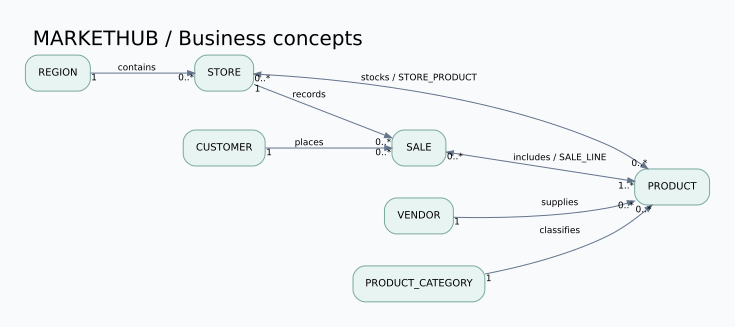

# MarketHubDB
### A SQL Server retail database for sales, inventory and reporting

MarketHubDB models a small multi-store retailer: who supplies each product, where stock is available, what customers purchase, and how sales vary across stores. It connects database design to a practical workflow: **record a sale, preserve its price, update inventory, and report the result.**



## What the project contains

- **Nine related tables** for regions, stores, vendors, categories, products, customers, stock, sales and sale lines.
- **Normalized stored facts** with primary keys, foreign keys, unique identifiers and quantity/price checks.
- **Product specialization:** perishable and durable products have different required attributes, enforced by one total/disjoint classification rule.
- **Transactional sale recording:** `RecordSale` validates a basket, records historical prices and decrements stock together.
- **A scoped sales-clerk database role:** execute the sale procedure without direct writes to sales and inventory tables. No login is created.
- **Five reports:** store revenue, monthly basket value, product demand, replenishment needs and repeat-customer activity.
- **Fictional seed data, SQL assertions and model diagrams** for an inspectable, reproducible portfolio project.

**Current verification:** model assets and source checks are available; SQL Server runtime execution has not yet been verified. See [verification evidence](evidence/README.md).

## Quick start

Use an isolated SQL Server development instance. Open the files in SQL Server Management Studio and execute them in order, stopping if a file raises an error:

| Order | Script | Purpose |
|---|---|---|
| 1 | [`00_create_database.sql`](sql/00_create_database.sql) | Create the isolated `MarketHubPortfolio` database |
| 2 | [`01_schema.sql`](sql/01_schema.sql) | Create tables, constraints, views, procedure and role |
| 3 | [`02_seed.sql`](sql/02_seed.sql) | Load the fictional retail scenario |
| 4 | [`03_reports.sql`](sql/03_reports.sql) | Display five reporting result sets |
| 5 | [`04_tests.sql`](sql/04_tests.sql) | Exercise integrity and transactional behavior |

The creation script refuses to overwrite an existing database. Scripts are intended for a fresh database and are not a production migration system. Do not run them against a database containing real customer information.

**Execution evidence:** inspect the SQL test results from your run before claiming a pass. Repository source and rendered diagrams are not substitutes for an executed SQL Server test. Recorded run artifacts belong in [`evidence/`](evidence/); do not infer a successful run from the presence of a test file.

### Windows command-line runner

If SQL Server and `sqlcmd` are already installed, the [PowerShell runner](run.ps1) executes the same ordered scripts using Windows integrated authentication and saves logs under `evidence/local/`:

```powershell
.\run.ps1 -Server 'localhost'
```

Use your actual instance name. The runner stops on errors and does not replace existing databases. Do not weaken authentication or certificate settings to work around a connection failure.

### Expected fictional-data checks

These figures are arithmetic expectations from the seed baskets, not claimed SQL output or real sales:

| Store | Expected revenue |
|---|---:|
| Harbor Market | $133.50 |
| Meadow Market | $54.50 |
| River Market | $74.00 |
| **Total: six sales, 27 units** | **$262.00** |

## Explore the design

| View | What it explains |
|---|---|
| [Conceptual diagram](docs/diagrams/conceptual.svg) | Business entities and their relationships |
| [Logical diagram](docs/diagrams/logical.svg) | Attributes, primary keys and foreign keys |
| [Physical diagram](docs/diagrams/physical.svg) | SQL Server types and nullability |
| [Product specialization](docs/diagrams/specialization.svg) | Perishable/durable classification |
| [Foreign-key map](docs/diagrams/referential-integrity.svg) | Referential-integrity paths |
| [Functional dependencies](docs/normalization.md) | Why facts belong in each relation |
| [Data dictionary](docs/data-dictionary.md) | Every physical column and key |
| [Relational schema](docs/relational-schema.md) | Alphabetical relation definitions |
| [Design decisions](docs/design.md) | Rules, assumptions and enforcement boundaries |
| [Guided walkthrough](docs/walkthrough.md) | A practical learning and demonstration sequence |

## Example: inspect a receipt

```sql
USE MarketHubPortfolio;
SELECT s.SaleId, s.SoldAt, st.StoreName,
       c.CustomerName, p.ProductName,
       l.Quantity, l.UnitPriceAtSale,
       l.Quantity * l.UnitPriceAtSale AS LineTotal
FROM dbo.SALE AS s
JOIN dbo.STORE AS st ON st.StoreId = s.StoreId
JOIN dbo.CUSTOMER AS c ON c.CustomerId = s.CustomerId
JOIN dbo.SALE_LINE AS l ON l.SaleId = s.SaleId
JOIN dbo.PRODUCT AS p ON p.ProductId = l.ProductId
ORDER BY s.SaleId, p.ProductName;
```

A sale line retains the price at purchase. Changing a product's current price must not rewrite earlier receipt totals.

## Scope

This is a relational database and SQL reporting project, not an online storefront or a live client system. Data are fictional. Product prices are illustrative. The model does not implement tax, refunds, payments, procurement, inventory lots, expiration tracking, shipping or production operations. `ShelfLifeDays` describes a product class; it is not a batch expiry date.

The business scenario originated in academic database-design work. This repository presents a separately rebuilt implementation and original documentation. See [references](docs/references.md) for design sources.

## Rebuild the diagrams

With Python 3 and Graphviz installed:

```bash
python tools/generate_model_docs.py
```

The generator reads the checked-in DDL and produces the data dictionary, relational schema, and SVG/PNG diagram assets. It does not execute SQL or connect to a server. Diagrams are provided as Graphviz source and rendered images, not as native ERwin project files.
