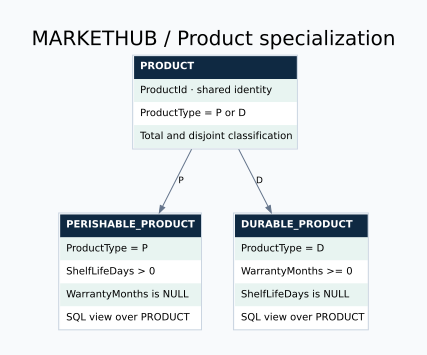

# Design decisions and business rules

## Scope and grain

The model describes a fictional retailer operating multiple stores. A `SALE` is one purchase at one store by one customer. A `SALE_LINE` is one product on that purchase. A `STORE_PRODUCT` row describes the stock position of one product at one store. A single sale cannot list the same product twice: quantities are consolidated under its composite key.

## Rules and enforcement

| Rule | Enforcement |
|---|---|
| Every store belongs to one region | Non-null `STORE.RegionId` foreign key |
| Every product has one vendor and one category | Non-null foreign keys in `PRODUCT` |
| Each sale belongs to one store and customer | Non-null foreign keys in `SALE` |
| Each line belongs to one sale and product | Foreign keys and composite primary key in `SALE_LINE` |
| A product SKU is unique | `UQ_PRODUCT_SKU` |
| Stock and reorder levels cannot be negative | `STORE_PRODUCT` CHECK constraints |
| Line quantities must be positive; prices nonnegative | `SALE_LINE` and `PRODUCT` CHECK constraints |
| A sale has at least one line | `RecordSale` rejects an empty basket |
| A sold product must be carried by that store with enough stock | Validation inside `RecordSale` |
| Sale booking and stock movement occur together | Explicit transaction, update/serializable-range locks and error handling in `RecordSale` |
| Historical sale prices remain independent of current prices | `SALE_LINE.UnitPriceAtSale` records the price when booked |
| Vendor/category/store/customer removal cannot orphan dependent rows | Foreign keys use default no-action behavior |
| Sales-clerk callers cannot bypass supported writes | Direct sales/inventory table changes denied to `MarketHubSalesClerk`; procedure execution granted |

The permissions above apply to members of that role without overriding elevated privileges. A database owner or system administrator can bypass the application workflow. The role does not create an application login or deploy an authentication system.

## Cardinality and lifecycle

A new vendor, category, region, store, product or customer can exist before its first dependent record. The physical model therefore permits zero-or-many children where a master record is being set up. Each child still has exactly one required parent.

A completed sale is different: the supported sale-recording procedure requires one or more items. The FK alone cannot enforce “a parent must have children.” The conceptual diagram describes sales created through that procedure; the physical FK diagram shows what declarative relationships alone enforce. This distinction is intentional, not an omitted constraint.

## Inventory and historical prices

Stock belongs to a **store/product pair**. A global product quantity would be ambiguous when products appear at several stores, so it is not stored on `PRODUCT`. A product's total stock can be derived with `SUM(StockQuantity)` over its inventory rows. Availability at a store means that row exists and has positive stock; global availability is not a substitute for local availability.

`CurrentUnitPrice` is a product's current catalog price. `UnitPriceAtSale` is a separate historical fact about a particular sale line. It is not recalculated when catalog prices change. Store-specific pricing and discounts are outside the current scope.

## Product specialization

Products have one of two types:

- **P / Perishable:** positive `ShelfLifeDays`, no `WarrantyMonths`.
- **D / Durable:** nonnegative `WarrantyMonths`, no `ShelfLifeDays`.

This is **total** (every product must select a valid type) and **disjoint** (a product cannot meet both branches). The SQL implementation uses single-table inheritance. `CK_PRODUCT_Subtype` rejects missing type-specific attributes, mixed attributes and invalid classifications. Two filtered views expose subtype rows; they are views, not separate stored subtype tables. Shelf life does not model expiration batches; a zero-month warranty means no warranty period is recorded.

## Field assumptions

- Optional addresses and contact fields hold descriptive data and are left blank when no fictional value is provided. There is no inferred postal-code-to-city dependency in this model.
- `County` is optional descriptive metadata on `REGION` and `PRODUCT_CATEGORY`. It is not a key, jurisdiction validation, country code or a required geographic mapping. The category field does not determine store geography.
- Region, store, vendor and category names are unique within this deliberately small scenario. A larger real-world model may need scoped uniqueness instead.
- Customer email is unique and required for this scenario; names are not identifiers. `CustomerName` is a computed display expression, not a second manually maintained name.
- `OpeningHours` is descriptive text; the database does not parse schedules or determine whether a store is open.
- Sample timestamps use a fixed fictional date range. They are not evidence of real trading activity.

## Reporting decisions

Reports aggregate receipt totals at sale grain before combining them with customers or stores. This avoids counting a sale once per line when computing average basket value. Date ranges use an inclusive start and exclusive end. LEFT JOINs preserve relevant entities with no matching activity so that zero sales are not confused with missing entities.

## Model artifacts

The [logical](diagrams/logical.svg), [physical](diagrams/physical.svg), [foreign-key](diagrams/referential-integrity.svg) and [dictionary](data-dictionary.md) artifacts are generated from the SQL schema. Their source files remain editable and inspectable. A schema change requires regeneration and review before publication.
