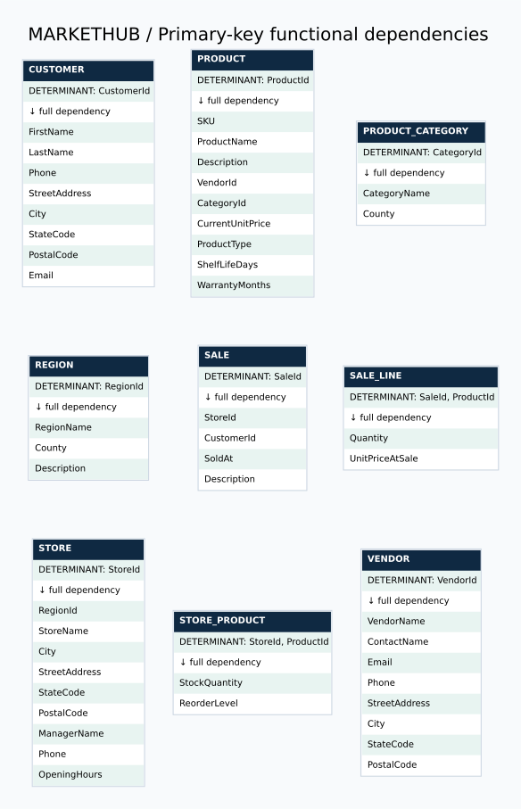

# Functional dependencies and normalization

## Reading the dependencies

`A → B` means that one value of determinant A identifies one value of B under this model's stated rules. A composite determinant is enclosed in parentheses. These are design dependencies, not dependencies inferred merely because a small sample happens to contain unique values.

The diagram shows each relation's primary-key dependency. Additional candidate keys are listed below; unique names and customer email are explicit scope assumptions enforced by the DDL.

| Relation | Determinant | Stored dependent attributes | Other candidate key |
|---|---|---|---|
| CUSTOMER | CustomerId | FirstName, LastName, Phone, StreetAddress, City, StateCode, PostalCode, Email | Email |
| PRODUCT | ProductId | SKU, ProductName, Description, VendorId, CategoryId, CurrentUnitPrice, ProductType, ShelfLifeDays, WarrantyMonths | SKU |
| PRODUCT_CATEGORY | CategoryId | CategoryName, County | CategoryName |
| REGION | RegionId | RegionName, County, Description | RegionName |
| SALE | SaleId | StoreId, CustomerId, SoldAt, Description | None specified |
| SALE_LINE | (SaleId, ProductId) | Quantity, UnitPriceAtSale | None specified |
| STORE | StoreId | RegionId, StoreName, City, StreetAddress, StateCode, PostalCode, ManagerName, Phone, OpeningHours | StoreName |
| STORE_PRODUCT | (StoreId, ProductId) | StockQuantity, ReorderLevel | None specified |
| VENDOR | VendorId | VendorName, ContactName, Email, Phone, StreetAddress, City, StateCode, PostalCode | VendorName |

For each listed alternate candidate key, that key determines the row's primary key and all remaining attributes. Names are unique only where explicitly constrained; customer and product display names are not assumed unique.

`CUSTOMER.CustomerName` is a computed presentation expression from first and last name. It is not an independently stored fact and is excluded from the stored dependency analysis. Subtype views, totals and reporting expressions are also derived rather than separately maintained relations.

## First normal form

Each base row has a key, fields hold one value of the declared domain, and repeating products are separate `SALE_LINE` rows rather than Product1/Product2 columns. Store inventory is represented by rows, not a list of stores inside a product field. Human-readable descriptions and opening-hours text are treated as scalar descriptive values, not as a normalized scheduling subsystem.

## Second normal form

The single-column-key relations have no proper subset of their primary key. For the two composite-key relations:

- `STORE_PRODUCT.StockQuantity` and `ReorderLevel` depend on the **combination** of a store and a product. They do not describe a product globally or a store without a product.
- `SALE_LINE.Quantity` and `UnitPriceAtSale` describe a product **in a specific sale**. A product can sell at different prices over time, and one sale can contain different products and quantities.

Product descriptions therefore belong in `PRODUCT`, not in either junction. A sale's store belongs in `SALE`, not in `SALE_LINE`: `SaleId → StoreId` would otherwise introduce a partial dependency on the sale-line key.

## Third normal form

The stored design is in 3NF under the documented dependencies: every nontrivial dependency used by the model has a candidate-key determinant, and non-key descriptive fields do not determine other independently stored facts within the same relation.

Examples:

- Vendor contact details are stored under `VENDOR`, not copied into products.
- Category names are stored under `PRODUCT_CATEGORY`, not repeated beside `CategoryId` in products.
- Region details are stored under `REGION`, not repeated in stores.
- Customer details are stored under `CUSTOMER`, not copied into every sale.
- Sale totals and company-wide product stock totals are derived from detail rows rather than redundantly stored.

This claim is scoped to the declared business rules. It does not assume that postal codes uniquely determine cities, that every manager is a separately modeled employee, or that a type code determines one fixed shelf-life value. If the business adds those dependencies, the schema should be reviewed again.

## What the separation prevents

| Without separation | Risk | Current design |
|---|---|---|
| Vendor phone repeated for every product | Inconsistent updates | One vendor record referenced by products |
| One global stock figure reused for each store | Incorrect local availability | Stock stored per store/product |
| Product current price used for old receipts | Historical totals change | Price recorded per sale line |
| Store ID repeated on sale lines | Partial dependency and mismatched receipt stores | Store recorded on sale header |
| Precomputed customer spending stored on customer row | Totals drift after sales change | Aggregate from receipts |

## Referential integrity versus normalization

Normalization organizes facts; constraints enforce valid relationships. The [foreign-key map](diagrams/referential-integrity.svg) and [data dictionary](data-dictionary.md) document the implemented keys. Neither normalization nor an FK alone guarantees a sale has at least one line or that enough stock exists. Those workflow rules belong to the transactional sale procedure and its restricted write path.
